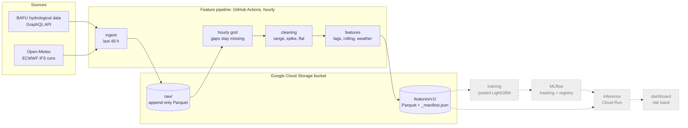

# FlowGuard

FlowGuard forecasts the water level of the Reuss and the Schächen in canton Uri, 24 hours ahead, and turns each forecast into a risk band: low water, normal or high water. Most flood tools look only at floods. I also want to catch the other end, droughts, which get less attention. The project is part of the HSLU module MLOps (HS26). It is a live system in the feature, training and inference (FTI) style, and it runs on a schedule.

## Stations

The data comes from the Swiss Federal Office for the Environment (BAFU). I forecast three stations and use three more as inputs or only collect them. I cut the original list of six after probing the data, and `docs/data_notes.md` shows why.

| BAFU no. | Station | Role | Why |
| --- | --- | --- | --- |
| 2087 | Reuss, Andermatt | Forecast | Water level and discharge, live. Upper end of the Reuss |
| 2491 | Schächen, Bürglen | Forecast | Water level and discharge, live |
| 2056 | Reuss, Seedorf | Forecast | Water level, discharge and temperature, live. Receives the other stations |
| 2492, 2649 | Diversions at Bürglen | Input | Discharge only, follows plant operation, so no forecast |
| 2299 | Alpbach, Erstfeld | Only collected | Not live, newest values arrive a day or more late |

## Status

Milestone 2 (data and features) is done. An hourly GitHub Actions job pulls BAFU and weather data into Cloud Storage and then builds the feature table. History from 2011 for BAFU and from August 2024 for the weather forecasts is backfilled. Not built yet: training, model registry, inference service and dashboard (milestones 3 and 4). GitHub starts the hourly job less often than hourly, and the 48-hour refetch means a run that does not start loses no data.

## Architecture

The feature pipeline exists. The training and inference parts (dashed, grey) are planned for milestones 3 and 4.



## How it works

- **Feature pipeline:** every hour a GitHub Actions job pulls new BAFU and weather data, builds the features and writes them as versioned Parquet files. The feature code lives once in `common/` and is used by training and inference.
- **Training pipeline:** a weekly or manual job reads the stored features, trains one pooled LightGBM model for all three stations and logs it in MLflow (planned, milestone 3).
- **Inference:** a service on Google Cloud Run loads the registered model, forecasts the level 24 hours ahead and shows the risk band on a dashboard (planned, milestone 4).
- **Target:** the change of the level over 24 hours in cm, added to the current level. The goal is to beat the simple baseline that tomorrow equals today at every station. At Andermatt I also aim for a mean absolute error of at most 3 cm. At Seedorf I aim for at most 80 percent of the baseline error, because the level there jumps with hydropeaking.
- **Risk bands:** low water below the station's own 10th percentile, high water above the 90th, normal in between. The percentiles come from the training period only. The bands describe high and low water relative to the station, not an official flood level.
- **Split:** three separate time segments (train, validation, test), cut at the same date for all stations, never shuffled.

## Data

- **Water data:** BAFU hydrological data service (GraphQL API, no login). I use the hourly means of discharge Q and water level W, and temperature WT at Seedorf. BAFU rejects queries over 10,000 rows, so the client asks in 30-day windows. Fallbacks: BAFU's monthly bulk files, hydrodaten.admin.ch and existenz.ch.
- **Weather data:** Open-Meteo, with ECMWF forecasts as they were issued, so the model never sees a forecast that did not exist yet. Weather data by [Open-Meteo.com](https://open-meteo.com/), licensed under [CC BY 4.0](https://creativecommons.org/licenses/by/4.0/). The forecasts are aggregated into features, so the data is changed.

### Storage

All data lives in one Cloud Storage bucket (`gs://flowguard-hs26-data`) or, for local work, in the folder `data/` (not in git). The location comes from `--store` or the environment variable `FLOWGUARD_STORE`.

```
raw/bafu/ingest_date=YYYY-MM-DD/<unit>__<fetch time>__<id>.parquet
raw/weather/run_date=YYYY-MM-DD/<unit>__<fetch time>__<id>.parquet
features/v1/station=<number>/month=<YYYY-MM>/features.parquet
features/v1/_manifest.json
```

- **Raw:** append-only. Files are never overwritten, so the first backfill stays as the "before" snapshot. Every row keeps `release_state` and `fetched_at`.
- **Features:** one Parquet file per station and month, written only if its content changed. `v1` is the feature version from `config/pipeline.yaml`; a change of the feature definitions gets a new folder. The manifest records the version, build time, commit, newest raw `fetched_at`, rows per station and the cleaning flag counts. See `docs/features.md`.
- **Release state:** BAFU validates data months later, so recent rows have an empty release state and history is validated. I keep the value as the live system saw it and accept the difference between training and live.
- **Gaps:** the hourly grid keeps gaps as missing values, nothing is interpolated, and every run prints a gap report.

## Pipelines and automation

| Workflow | Trigger | What it does |
| --- | --- | --- |
| `ci.yml` | every push and pull request | `uv sync --locked`, ruff check and format check, pytest, and a Docker build without push |
| `ingest.yml` | every hour at minute 17 (UTC) and manual | job `ingest`: the hourly ingest into the bucket. Job `features` (after `ingest`, timeout 15 min): incremental feature build from the first day of the previous month on, into `features/v1/` |
| `backfill.yml` | manual, input `source` = `bafu` or `weather` | the resumable backfill into the bucket (timeout 5.5 h) |
| `features.yml` | manual, optional input `since` (YYYY-MM-DD) | builds the feature table from the raw data in the bucket and writes it to `features/v1/` (timeout 30 min) |

The runner keeps nothing, everything goes to the bucket. The `features` job of `ingest.yml` is a separate job, so a failing build never turns the `ingest` job red or stops the data collection. It shares the concurrency group `features` with `features.yml` (a manual full build and the hourly build never write at the same time; a running build is never cancelled) and prints the build report to the log and the job summary. Every other workflow has its own concurrency group, so two runs of the same workflow never overlap. If a backfill stops (timeout or HTTP 429), start it again with the same source: it continues with the units that are not stored yet.

GitHub does not guarantee the schedule. A run can start late or be skipped; the 48-hour refetch of the ingest closes such gaps.

## Why this stack

- **GitHub Actions** gives me the hourly schedule and the tests in the same place as the code, and it is free for this size.
- **Docker** gives the same environment on my laptop, in CI and on Cloud Run.
- **LightGBM** is a strong, fast model for tabular features and handles missing values, which happen with live data.
- **MLflow** tracks experiments and holds the model registry. It will run on DagsHub, which hosts one MLflow server per repository for free and accepts a token from GitHub Actions and Cloud Run. This is set up in milestone 3. Until then it runs on a local file store.
- **uv** gives a locked environment, so my laptop, CI and the Docker image install the same versions.
- **Parquet on Google Cloud Storage** is cheap and columnar and needs no database server.
- **Google Cloud (Cloud Run, Cloud Storage)** carries the $50 course credit.

## Known limits

- BAFU validates data only months later. The model trains mostly on validated values and runs on unchecked ones. I keep the release state of every row and report the unvalidated part of the test period separately.
- Weather forecasts as issued exist only from 2024, so the weather model trains on about 2.2 years.
- About 500 km2 of the Reuss catchment between Andermatt and Seedorf has no gauge. Weather points stand in for it.
- Three forecast stations are few, so results for single extreme events are uncertain.
- Eleven weather forecast runs do not exist at Open-Meteo. For those hours the pipeline falls back to the newest earlier run, or leaves the value missing.
- The validation and test periods are quiet. Some risk bands have too few rows or episodes there, so I report them as not evaluable instead of giving a number.
- GitHub starts the hourly job less often than hourly, in the first week about every 4 to 8 hours. Every run fetches the last 48 hours again, so a run that does not start loses no data. If BAFU has not published an hour, it stays a missing hour in the data.

## Setup and run

You need Python 3.12, [uv](https://docs.astral.sh/uv/) and, for the image, Docker.

```bash
git clone https://github.com/WunderlinRaphael/FlowGuard.git
cd FlowGuard
uv sync --locked
cp .env.example .env     # optional; .env is ignored by git
```

Tests and style checks (no network and no key needed):

```bash
uv run pytest
uv run ruff check .
uv run ruff format --check .
```

### Try it in a few minutes (no Google login)

This fetches a short recent history into the local folder `data/`, runs one ingest and builds the features. It needs internet but no key and no login. Use dates about 10 days (BAFU) and 5 days (weather) back; the example is for 3 November 2026. The weather features need three days of runs before the first hour, so a shorter range gives almost no weather columns.

```bash
uv run python -m flowguard.features.backfill --bafu-start 2026-10-24 --weather-start 2026-10-29
uv run python -m flowguard.features.ingest
uv run python -m flowguard.features.build
```

This took about 1.5 minutes in total (backfill about 1 minute). The build printed 251 rows per forecast station, 226 of them with a target and 60 with weather features. The first line of the build output shows the feature version. Make sure `FLOWGUARD_STORE` is not set to a `gs://` path in `.env`. To start over, delete `data/`.

### Storage location and Google Cloud login

The commands below write to `data/` by default. To use the bucket instead, set `FLOWGUARD_STORE=gs://flowguard-hs26-data` in `.env` (or pass `--store`). Google Cloud storage uses your application default credentials, so log in once:

```bash
gcloud auth application-default login
```

Alternatively set `GOOGLE_APPLICATION_CREDENTIALS` to the path of a service account key file. Reading and writing the bucket needs a role on it; ask the project owner. Without a login, work with the local folder.

### Commands

Data probes (need internet, no key). They print to the terminal and store nothing:

```bash
uv run python scripts/probe_bafu.py      # BAFU stations, gaps, release states, takes a few minutes
uv run python scripts/probe_weather.py   # Open-Meteo runs, delay, request counts
```

`probe_weather.py --poll --cycles 3` waits for the next model runs and measures their delay, which takes hours.

Fetch raw hourly values from BAFU (UTC datetimes, nothing is stored):

```python
from datetime import UTC, datetime
from flowguard.common.stations import load_stations
from flowguard.features.bafu_client import BafuClient

rows = BafuClient().fetch_stations(
    load_stations(), datetime(2026, 10, 19, tzinfo=UTC), datetime(2026, 10, 20, tzinfo=UTC)
)
```

Run it with `uv run python`. Each row is a dict with station, timestamp, parameter, value, unit, release_state and fetched_at.

Turn the raw rows into a regular hourly UTC grid and print the gap report (nothing is stored). Gaps stay missing, nothing is filled:

```python
from flowguard.features.gap_report import format_report, gap_report
from flowguard.features.hourly_grid import build_hourly_grid

result = build_hourly_grid(rows)  # result.grid is a pandas DataFrame, result.duplicates a count
print(format_report(gap_report(result.grid, result.duplicates)))
```

Fetch raw weather from Open-Meteo (no key, nothing is stored). The settings come from `config/pipeline.yaml`. `select_run` picks the forecast run that was available for the origin hour `t`, from `t` and the config only:

```python
from datetime import UTC, datetime, timedelta
from flowguard.common.pipeline_config import load_pipeline_config
from flowguard.features.weather_client import WeatherClient, select_run

config = load_pipeline_config()
t = datetime(2026, 10, 21, 10, tzinfo=UTC)
run = select_run(t, as_of_offset=config.as_of_offset, min_run_age=config.min_run_age)

client = WeatherClient()
forecast = client.fetch_run(config.weather_points, run)  # 48 h run, hour 0 left out
observed = client.fetch_observed(
    config.weather_points, t - timedelta(hours=72), t + timedelta(hours=1)
)
```

Each row is a dict with point, valid_time, run_start (empty for observed hours), parameter, value, unit and fetched_at.

Store raw data (append-only Parquet, see Storage above). `--store` takes a local folder or a `gs://` URI. Both commands need internet, no key:

```bash
uv run python -m flowguard.features.backfill --dry-run   # request counts, fetches nothing
uv run python -m flowguard.features.backfill             # BAFU from 2011-01-01, weather runs from 07.08.2024
uv run python -m flowguard.features.ingest               # last 48 h of BAFU, new weather runs, gap report
```

The backfill is resumable: it skips what is already stored, so after an error or a stop (Ctrl+C) run the same command again. The full BAFU backfill takes about 75 minutes, the weather backfill about an hour. Options: `--limit N` (at most N requests per source), `--source bafu|weather|all`, `--bafu-start` and `--weather-start` (YYYY-MM-DD, override `config/pipeline.yaml`, for small tests). The ingest can be run as often as you like: it writes only new or changed BAFU rows and weather runs that are not stored yet.

Build the feature table from the raw store (see `docs/features.md`). `--store` and `FLOWGUARD_STORE` work as above:

```bash
uv run python -m flowguard.features.build                      # full build (about 25 s for the local history)
uv run python -m flowguard.features.build --since 2026-10-01   # only the months from October 2026 on
```

### Docker

The image runs the hourly ingest by default. The backfill runs from the same image by changing the entry point:

```bash
docker build -t flowguard .
docker run --rm -v "$PWD/data:/app/data" flowguard --store data
docker run --rm -v "$PWD/data:/app/data" --entrypoint python flowguard -m flowguard.features.backfill --dry-run
```

### Secrets and settings

No secret is stored in the repository. `.env.example` lists the variable names only (`FLOWGUARD_STORE`); a real `.env` stays local and is ignored by git. The workflows need these entries in the repository settings (Settings > Secrets and variables > Actions):

| Name | Type | Content |
| --- | --- | --- |
| `GCP_SA_KEY` | secret | JSON key of the service account that may write to the bucket |
| `FLOWGUARD_STORE` | variable | bucket URI, `gs://flowguard-hs26-data` |
| `GCP_PROJECT` | variable | Google Cloud project ID, `flowguard-hs26` |

Nothing else is needed in the repository to clone, test and build.

## Project layout

| Path | Content |
| --- | --- |
| `src/flowguard/common/` | Station list loader (`stations.py`), pipeline settings loader (`pipeline_config.py`), append-only raw store (`raw_store.py`), range, spike and flat-line checks with a causal mode for features (`cleaning.py`), chronological split with embargo (`split.py`), lag and rolling features per target station (`features.py`, W and Q of the station, its upstream slots and the diversion flows, plus the 24 h target), weather composite series and weather features per catchment point from the stored model runs (`weather_features.py`), the joined feature table (`feature_table.py`) |
| `src/flowguard/features/` | BAFU GraphQL client (`bafu_client.py`), Open-Meteo weather client (`weather_client.py`), hourly grid (`hourly_grid.py`), gap report (`gap_report.py`), backfill command (`backfill.py`), hourly ingest command (`ingest.py`), feature table storage and manifest (`feature_store.py`), feature build command (`build.py`) |
| `src/flowguard/training/`, `src/flowguard/inference/` | Planned, empty for now |
| `config/` | `stations.yaml`: stations, roles, parameters and upstream mapping. `pipeline.yaml`: start dates, as-of rule, weather points, cleaning thresholds, split dates and feature version |
| `scripts/` | One-off probes of the BAFU and Open-Meteo APIs and the baseline analysis behind `docs/eda_notes.md` |
| `data/` | Local copy of the store (`raw/`, `features/`), not in git |
| `tests/` | Unit tests and recorded BAFU and Open-Meteo responses (`fixtures/`) |
| `docs/` | [`data_notes.md`](docs/data_notes.md) (probe results, cleaning thresholds, fallback sources), [`features.md`](docs/features.md) (feature catalogue, storage, versioning), [`eda_notes.md`](docs/eda_notes.md) (persistence baseline, event counts, travel time), [`proposal.pdf`](docs/proposal.pdf); [`ms2_summary.pdf`](docs/ms2_summary.pdf) |
| `notebooks/`, `ui/` | Planned, empty for now |
| `.github/workflows/` | `ci.yml`, `ingest.yml`, `backfill.yml`, `features.yml` |
| `Dockerfile`, `.dockerignore` | Two-stage image (python:3.12-slim, uv, non-root user), default command is the ingest |
| `pyproject.toml`, `uv.lock` | Dependencies, pinned |
| `.env.example` | Template for environment variables (`FLOWGUARD_STORE`) |

## Related work

Four earlier projects from the KTH course ID2223 work on similar problems. The UK flooding project (2023/24) is a batch system with a dashboard on the national flood-monitoring data. The Stockholm streamflow project (2022/23) predicts streamflow at three locations with XGBoost, using SMHI data and Open-Meteo weather, and runs on Modal and Hopsworks. "Predicting Water Levels" (2025/26) forecasts daily lake levels with one tree model per lake, from lagged levels and weather at surrounding points. "Global River Flooding Prediction" (2025/26) classifies flood danger with logistic regression on streamed data.

FlowGuard differs in five ways. It forecasts hourly and 24 hours ahead, not daily. It works on a connected gauge network: measured upstream gauges and a diversion flow feed the forecast stations in one pooled model (planned). It will score the high and the low water band against a persistence baseline (tomorrow equals today), so a result only counts if it beats that. It uses weather forecasts as they were issued at the time of the prediction, so no later information leaks into training. And the split, the embargo and the BAFU release state are documented in `docs/`. I do not claim trend features or a chronological split as new, they are standard.
